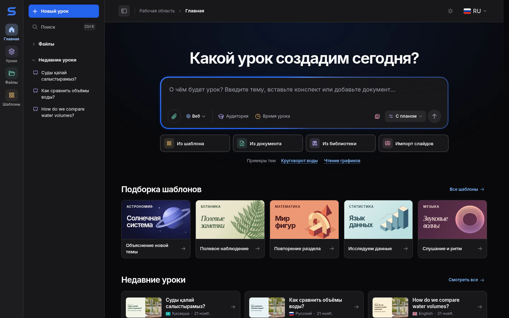
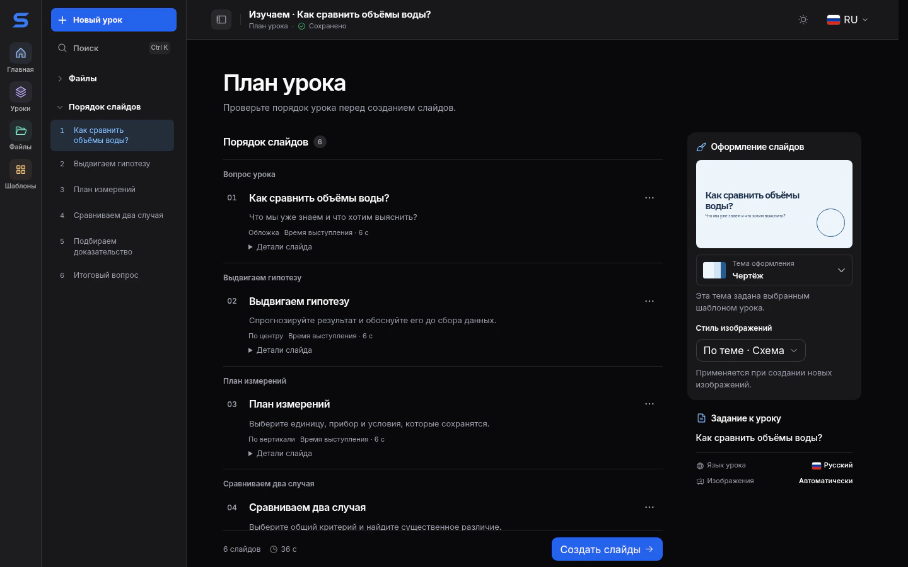
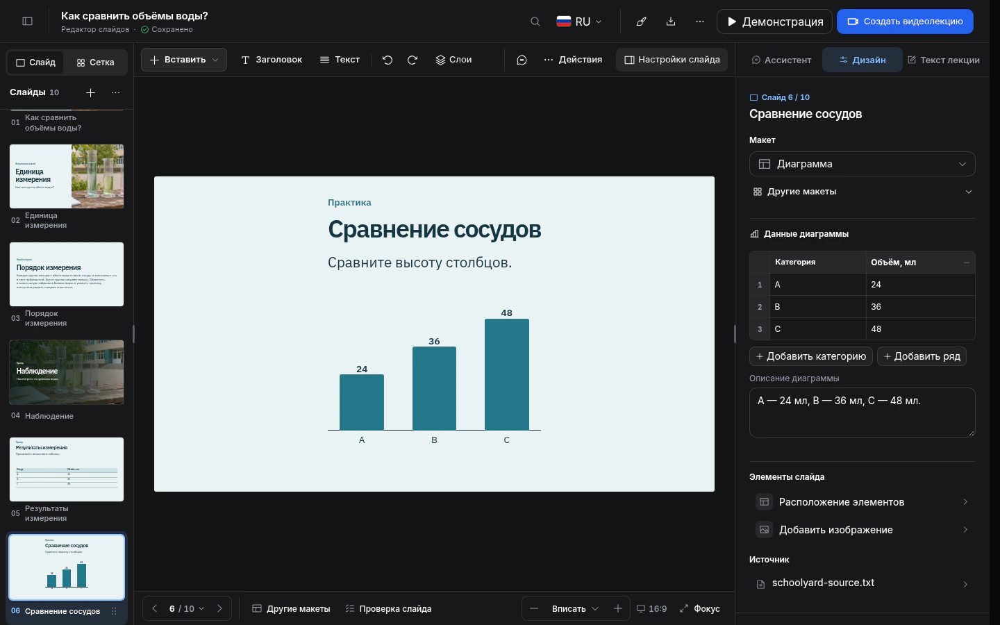
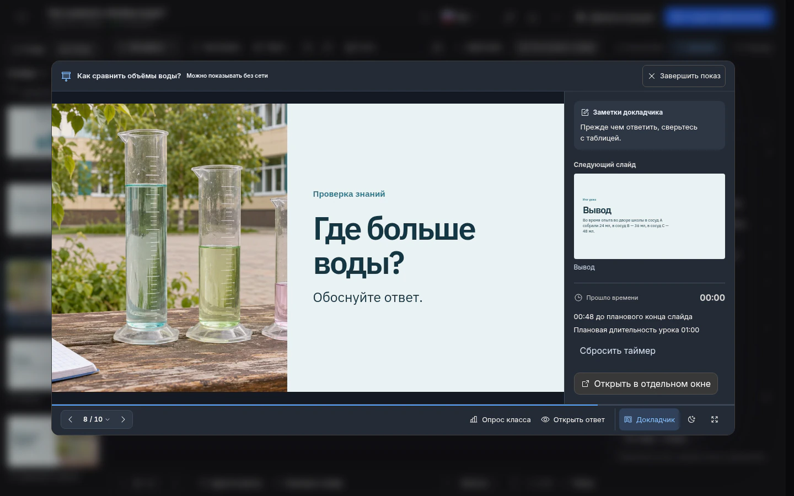
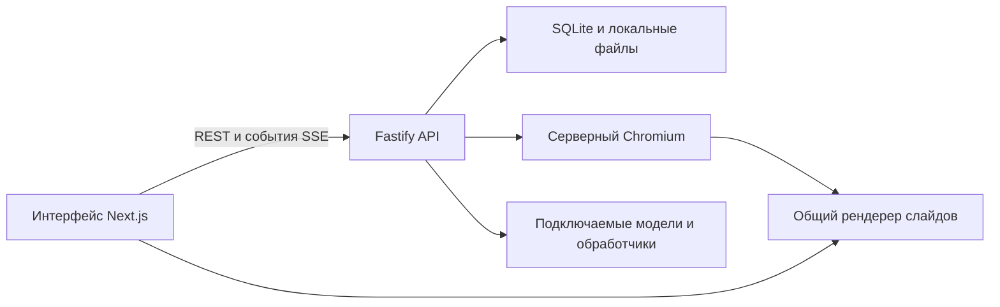

# Sabaq Studio

Sabaq Studio помогает преподавателю подготовить презентацию для занятия. Начните с темы, учебного материала, шаблона или файла PowerPoint. Уточните план, отредактируйте слайды и запустите показ или скачайте файл. Интерфейс и содержание уроков доступны на казахском, русском и английском языках.

В локальном режиме можно пройти весь путь от плана до показа без аккаунта и ключей. Для генерации текста по произвольной теме, новых иллюстраций, распознавания речи и озвученного видео настройте соответствующие сервисы.



[Запуск](#запуск) · [Возможности](#возможности) · [Скриншоты](#скриншоты) · [Интеграции](#интеграции) · [Проверки](#проверки) · [Приёмка](#что-осталось-до-приёмки)

## Запуск

Понадобятся Bun 1.4.2 и Node.js 22.13 или новее. Выполните команды из корня репозитория. [Установка Bun](https://bun.com/docs/installation) · [Загрузка Node.js](https://nodejs.org/en/download)

```sh
bun install --frozen-lockfile
bun run dev
```

Откройте [Sabaq Studio](http://127.0.0.1:5173/). Next.js обслуживает интерфейс на порту `5173` и перенаправляет запросы API на Fastify, работающий на порту `4318`. При первом запуске с пустой базой в библиотеке появятся три языковые версии демонстрационного урока об измерении объёма воды.

Откройте демонстрационный урок, измените текст, выберите другой макет и запустите показ. Чтобы проверить создание с нуля, введите тему на главной и оставьте **Режим примера** в настройках генерации. Проверьте план и создайте слайды. Этот режим использует встроенные материалы. Для генерации нового текста по теме подключите локальную модель или AlemLLM.

### Собранная версия

В собранной версии Fastify обслуживает интерфейс и API по одному адресу.

```sh
bun run build
bun run start
```

Откройте [собранную студию](http://127.0.0.1:4318/). Для другого порта задайте `PORT` при запуске. По умолчанию сервер слушает `127.0.0.1`. Путь `/api/openapi.json` открывает описание маршрутов, а `/api/capabilities` показывает подключённые возможности.

### Данные и настройки

Скопируйте `.env.example` в `.env`, если подключаете сервисы или меняете настройки. Перезапустите API после изменений. Ключи задаются на сервере. [Переменные окружения](.env.example)

При локальном запуске база по умолчанию находится в `.data/studio.sqlite`. Укажите абсолютный `STUDIO_DB_PATH`, чтобы открыть другой экземпляр студии с отдельными уроками. Сервер хранит медиа и результаты экспорта в соседних каталогах. Для резервной копии установки нужны база и связанные файлы. `STUDIO_STATIC_ROOT` и `STUDIO_CATALOG_ROOT` задают отдельные пути к собранному интерфейсу и встроенным материалам.

## Возможности

| Задача | Что доступно |
| --- | --- |
| Подготовить урок | Создание по теме, учебному тексту или одному из 23 шаблонов. Параметры аудитории, языка, длительности, иллюстраций и контрольного вопроса. Генерируемый план рассчитан на 3–40 слайдов. |
| Уточнить план | Заголовки, задачи, макеты, описание иллюстраций и черновые заметки к каждому слайду. Есть предварительный просмотр, смена порядка и запуск без отдельного согласования. План можно открыть позднее. |
| Работать по мере генерации | Готовые слайды открываются до завершения всей работы. Отмена сохраняет полученный результат, а неудачную попытку можно повторить для отдельного слайда. |
| Собрать слайд | Редактирование текста на холсте, 16 тем оформления, адаптивные макеты и ручное размещение. Можно добавлять таблицы, диаграммы, схемы, изображения, формулы, пиктограммы, фигуры и отдельные текстовые блоки. |
| Проверить и сохранить | Автосохранение, история версий, восстановление и обработка конфликтов между вкладками. Проверка макета отмечает переполнение, наложения, проблемы контраста и обрезки. |
| Использовать помощника | Вопросы по уроку и приложенным файлам, выдержки из источников, предложения по правкам и предварительный просмотр результата. Студия применяет предложение после подтверждения. |
| Показать в классе | Полноэкранный показ, окно докладчика с заметками и таймером, раскрытие ответов. Открытый показ работает после потери сети, если успел загрузить изображения. Опросы, викторины и облако слов открываются по коду. |
| Подготовить версию на другом языке | Перевод слайдов и заметок создаёт отдельный урок. Для произвольного текста нужна настроенная локальная модель перевода. |
| Поделиться в организации | Доступ на просмотр или редактирование, комментарии, оформление и шаблоны организации. Одновременное редактирование заголовков, основного текста и заметок включается отдельно. |

### Импорт и экспорт

**Учебный текст** можно вставить вручную, выбрать из **Моих файлов** или извлечь из TXT, DOCX и PDF с текстовым слоем. Для сканов PDF и фотографий поддерживаемых форматов можно подключить распознавание текста (OCR). Ссылки на выдержки помогают сверить урок с исходным материалом.

**Готовые слайды** можно импортировать из PPTX, PDF, PNG, JPEG или WebP. Редактируемый импорт PPTX переносит поддерживаемые элементы и заметки. Если сложное оформление нельзя перенести по слоям, студия сохраняет внешний вид слайда как изображение. Оформление из PPTX можно использовать как основу нового урока. Импорт презентации поддерживает до 40 страниц и файлов до 20 МБ. Лимит для изображений составляет 10 МБ.

**Экспорт** сохраняет выбранную ревизию. PPTX содержит редактируемые тексты, таблицы и диаграммы, а также заметки докладчика. PDF сохраняет текст для выделения и поиска, а PNG выгружает выбранный слайд. Если работа над файлом продолжается, диалог можно закрыть и вернуться к результату позднее.

| Возможность | Системные зависимости |
| --- | --- |
| Чтение DOCX и текста PDF | Python 3 для DOCX, Poppler (`pdftotext`) для PDF |
| Импорт слайдов | Linux с доступными пользовательскими пространствами имён, Bubblewrap, util-linux (`prlimit`), Python 3, LibreOffice Impress, Poppler (`pdfinfo`, `pdftocairo`) и ImageMagick 7 (`magick`) |
| OCR сканов и локальная обработка аудио | Poppler для страниц PDF, Bubblewrap и util-linux для изоляции, FFmpeg для аудио. Tesseract с языками `eng+kaz+rus` служит резервным распознавателем при сбое OCR-сервиса. |
| PDF, PNG, проверка макета и видео | Chromium из Playwright либо системный Chromium. Для явного выбора задайте `CHROMIUM_PATH`. Для видеопроверки также нужны FFmpeg с `ffprobe`, Bubblewrap, util-linux и инструменты проверки маркировки. |

Системные конвертеры нужны при работе с соответствующими форматами. Для первого запуска и просмотра встроенного урока хватит Bun и Node.js.

## Скриншоты

**План урока.** Перед созданием слайдов можно уточнить содержание и порядок, проверить макеты и подправить заметки.



**Редактор.** Данные диаграммы можно поправить в таблице справа и сразу увидеть результат на слайде.



**Показ.** Откройте слайд для класса, держите заметки в окне докладчика и раскрывайте ответы по ходу занятия.



## Интеграции

Запускайте только те сервисы, которые нужны для выбранного сценария. Для локальных моделей в Ollama используйте установленный на сервере тег и числовой loopback-адрес наподобие `http://127.0.0.1:11434`. [Ollama API](https://docs.ollama.com/api/introduction)

| Сценарий | Настройки |
| --- | --- |
| Локальная генерация и помощник | `STUDIO_AUTHORING_MODEL`, `STUDIO_ASSISTANT_OLLAMA_MODEL`, `STUDIO_OLLAMA_URL`. Для отдельной модели перевода задайте `STUDIO_TRANSLATION_OLLAMA_MODEL`. |
| Поиск по учебным материалам | Локальный полнотекстовый индекс SQLite FTS5. `STUDIO_EMBEDDING_MODEL` добавляет поиск по смыслу через Ollama. `STUDIO_MEM0_URL` подключает локальную службу для поиска по сохранённым предпочтениям урока. |
| Alem Plus | `ALEM_API_KEY` включает AlemLLM для создания по теме и доступных правок. Отдельные ключи включают эмбеддинги, ранжирование, диктовку и OCR. При `STUDIO_CLOUD_SOURCE_RAG=1` отправка найденных выдержек в Alem требует подтверждения для каждого запроса. |
| Иллюстрации | `STUDIO_IMAGE_ENDPOINT`, `STUDIO_IMAGE_MODEL`, `STUDIO_IMAGE_API_KEY` для сервиса генерации. `STUDIO_IMAGE_VERIFY_MODEL` задаёт локальную модель, которая проверяет изображения. Прямой OpenAI доступен в локальном режиме предварительного просмотра. |
| Открытые источники | `STUDIO_RESEARCH_PROVIDER`, `STUDIO_SEARCH_URL` и `STUDIO_RESEARCH_TOPICS` управляют настроенным поиском. Ключ `EXA_API_KEY` подключает режимы поиска и исследования через Exa. Для ответов и планов по результатам поиска через Exa также нужен `ALEM_API_KEY`. |
| Модерация | `STUDIO_MODERATION_OLLAMA_MODEL` включает локальную модель. Для собранной версии в режиме gateway она обязательна. |
| Озвучка и видео | В локальном режиме серверный ключ ElevenLabs включает прослушивание заметок. Переменные `STUDIO_VIDEO_*` подключают обработчик видео и независимую проверку маркировки. |

### Озвученный ролик

Добавьте заметки хотя бы к одному слайду и откройте создание видеоурока. Диалог предлагает кадры 16:9, 9:16 и 1:1, субтитры и показ частей слайда по абзацам заметок там, где это поддерживает материал. Встроенная озвучка использует язык урока. Для записи на другом языке с этим обработчиком сначала создайте языковую версию урока.

Встроенный обработчик использует ElevenLabs для речи и FFmpeg для сборки MP4. Для локальной демонстрации на Linux x86-64 выполните команду ниже. Скрипт проверит контрольную сумму `c2patool` и создаст тестовые сертификаты в `.data/video-release/`. Для команды нужны Python 3 и OpenSSL. [Подготовка локальной подписи](apps/api/tools/setup-local-video-release.py)

```sh
python3 apps/api/tools/setup-local-video-release.py
```

Добавьте в `.env` ключ `ELEVENLABS_API_KEY`, задайте `STUDIO_VIDEO_LOCAL_WORKER=1` и оставьте `STUDIO_VIDEO_WORKER_URL` пустым. Укажите абсолютные пути к файлам в таблице и перезапустите студию. [Переменные для видео](.env.example)

| Переменная | Файл |
| --- | --- |
| `STUDIO_VIDEO_C2PATOOL` | `.data/video-release/c2patool` |
| `STUDIO_VIDEO_SIGNING_MANIFEST` | `.data/video-release/signing.json` |
| `STUDIO_VIDEO_C2PA_ANCHORS` | `.data/video-release/root.pem` |
| `STUDIO_VIDEO_MARK_EMBEDDER` | `apps/api/tools/video_watermark_embed.py` |
| `STUDIO_VIDEO_MARK_VERIFIER` | `apps/api/tools/video_watermark_verify.py` |

Студия выдаёт MP4 после проверки видимой метки «ИИ», водяного знака и подписи C2PA.

### Цифровой аватар преподавателя

На общем стенде откройте **Мой аватар и голос** в диалоге экспорта, подтвердите согласие и перейдите на страницу оператора. После регистрации нажмите **Проверить статус**. Когда оператор подтвердит действующее согласие, выберите **С аватаром**, язык озвучки, сторону кадра и размещение. Предпросмотр показывает отведённую аватару область. В этом же разделе можно запросить удаление образцов, аватара и записей. Студия сразу закрывает доступ к ролику и показывает статус удаления, пока оператор обрабатывает запрос.

Для общего стенда в режиме gateway подключите региональный обработчик и оператора согласий. Задайте `STUDIO_VIDEO_REGION=KZ`, `STUDIO_VIDEO_WORKER_URL` и `STUDIO_VIDEO_PIPELINE_VERSION`, оставьте `STUDIO_VIDEO_LOCAL_WORKER=0`. Укажите настройки проверки маркировки и добавьте адреса обработчика и оператора в `STUDIO_KZ_PROVIDER_ORIGINS`. Оператор задаётся через `STUDIO_BIOMETRIC_VAULT_URL`, `STUDIO_BIOMETRIC_VAULT_KEY` и `STUDIO_BIOMETRIC_CONSENT_VERSION`. Используйте ключ обработчика `STUDIO_VIDEO_WORKER_KEY`, если он требует аутентификацию. [Переменные для видео](.env.example)

Для однопользовательской демонстрации подключите внешний обработчик и задайте `STUDIO_VIDEO_AVATAR_ID`, выданный оператором. Регистрация и отзыв согласия в студии доступны через шлюз.

Внешний обработчик получает выбранный язык озвучки и язык исходных заметок. Поддержку языков, выпуск MP4 с независимо проверенной маркировкой и удаление данных с подтверждением оператора проверяйте на целевом стенде. [Протокол приёмки](docs/acceptance.md)

### Совместная установка и хранение данных

Для общего доступа используйте `STUDIO_AUTH_MODE=gateway` и отдельный шлюз, который проверяет личность. Шлюз удаляет входящие от клиента заголовки `x-studio-*` и сам выставляет `x-studio-gateway`, `x-studio-org`, `x-studio-user` и, при необходимости, `x-studio-role`. Задайте общий `STUDIO_GATEWAY_SECRET` длиной от 32 символов и оставьте API доступным только шлюзу. Предусмотрены роли `org-admin` и `system-admin`. [Проверка доступа](apps/api/src/access/access.ts)

Для установки по ТЗ подтвердите размещение обработки, хранилищ и резервных копий в Казахстане. В `STUDIO_KZ_PROVIDER_ORIGINS` добавляйте точные HTTPS-адреса согласованных сервисов. Для видео в режиме gateway требуется `STUDIO_VIDEO_REGION=KZ`. Клиент ElevenLabs и встроенный обработчик озвучки работают только в локальном режиме. Проверьте сетевые запросы браузера, API и обработчиков. Публичный поиск требует согласованного сервиса и запросов без персональных данных. [Проверка адресов](apps/api/src/access/provider-origins.ts) · [Политика видеосервиса](apps/api/src/video/video-provider.ts)

## Архитектура



| Каталог | Ответственность |
| --- | --- |
| [`apps/web`](apps/web) | Интерфейс Next.js и React, редактор Tiptap, режим показа, библиотека и помощь по уроку |
| [`apps/api`](apps/api) | Fastify, SQLite, права доступа, ревизии, очереди генерации и экспорта, загрузка файлов и интеграции |
| [`packages/lesson`](packages/lesson) | Модель урока, макеты и темы, структура слайда и операции редактирования |
| [`packages/contracts`](packages/contracts) | Схемы запросов, ответов и событий |
| [`packages/agent`](packages/agent) | Решения помощника, проверка инструментов и исходных сведений |
| [`packages/slide-renderer`](packages/slide-renderer) | Общий рендерер на DOM и SVG для холста, миниатюр, показа и серверной отрисовки |
| [`tests`](tests) | Браузерные сценарии Playwright и тестовые файлы |
| [`notices`](notices) | Уведомления об используемых сторонних компонентах |

SQLite хранит версии уроков и состояние заданий. Интерфейс получает обновления генерации через Server-Sent Events (SSE). Для PPTX отдельный экспортёр преобразует модель урока в редактируемые элементы Office.

## Проверки

На Linux с установленными системными конвертерами запустите проверки типов, сборку, серверные тесты и сценарии в Chromium. Playwright поднимает отдельную локальную студию с временной базой и демонстрационными данными.

```sh
bun run typecheck
bun run build
bunx playwright install chromium
bun run test
STUDIO_E2E_BUILT=1 bun run test:e2e
```

Для системного Chromium задайте `CHROMIUM_PATH`. Если браузеру нужны системные библиотеки, установите их по инструкции Playwright. Для запуска на dev-сервере опустите `STUDIO_E2E_BUILT`. [Установка браузеров Playwright](https://playwright.dev/docs/browsers)

Отдельные команды проверяют шлюз и создают отчёты по моделям и макетам.

```sh
STUDIO_E2E_ORGANIZATION=1 bun run test:e2e
STUDIO_E2E_COEDIT=1 bun run test:e2e
bun run eval:layout
bun run eval:retrieval --lexical-only
bun run eval:jev --dry-run
```

Для проверки совместного редактирования с порогом в одну секунду добавьте `STUDIO_COEDIT_GATE=1`. С установленной моделью эмбеддингов можно запустить `bun run eval:retrieval` и сравнить текстовый и гибридный поиск. Для `bun run eval:moderation` сначала настройте `STUDIO_MODERATION_OLLAMA_MODEL`. `eval:jev --dry-run` выводит публичные примеры для проверки подтверждённости утверждений без вызова API. [Конфигурация тестов](playwright.config.ts) · [Инструменты оценки](apps/api/tools)

## Что осталось до приёмки

Локальную демонстрацию можно запустить на встроенном уроке. Для промышленной приёмки нужны прогоны на целевой инфраструктуре и учебных материалах. [Протокол приёмки](docs/acceptance.md)

- Пройти полный цикл видеоурока с аватаром преподавателя, согласиями и проверкой удаления связанных данных.
- Подтвердить хранение и обработку в Казахстане сетевыми журналами и проверкой поставщиков.
- Сверить численные данные и цитаты с источниками. Автоматическая проверка пока может пропустить число, приписанное другой величине, или цитату с неверной атрибуцией.
- Измерить время генерации на 20 казахских и 20 русских темах. Цели ТЗ для десяти слайдов с пятью изображениями составляют 60 секунд по медиане и 90 секунд по 90-му перцентилю.
- Проверить макеты на 100 презентациях, экспорт в настольных PowerPoint и LibreOffice, доступность с экранными дикторами и двухэкранный показ. Критерий преподавательского пилота составляет 7 из 10 участников, готовых показать самостоятельно собранный за пять минут урок без доработки.
